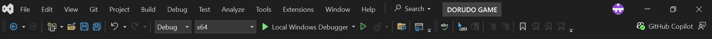
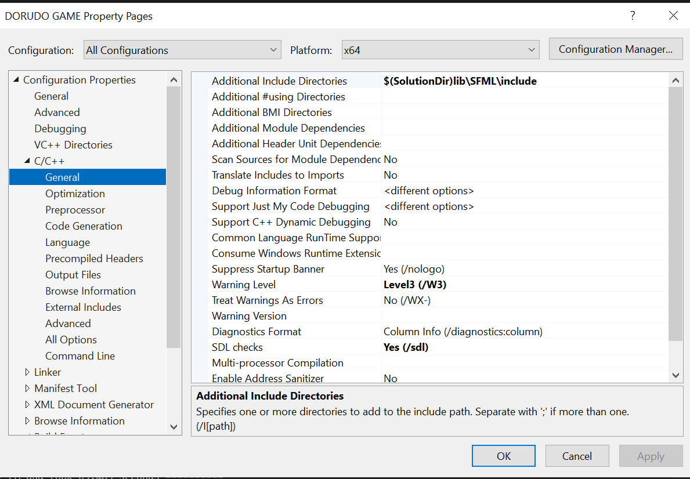
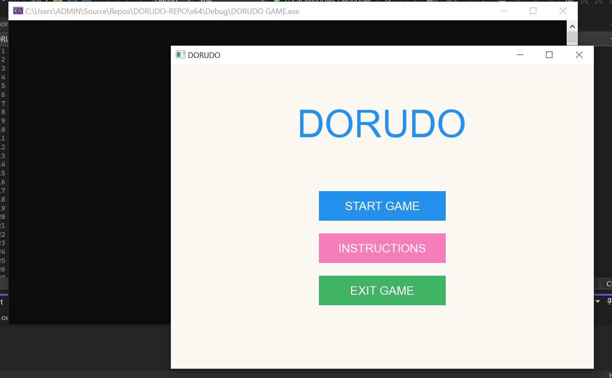
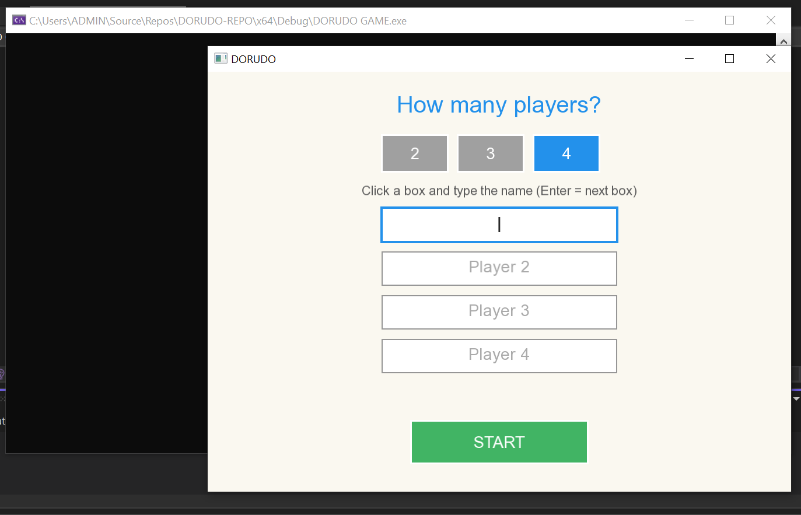
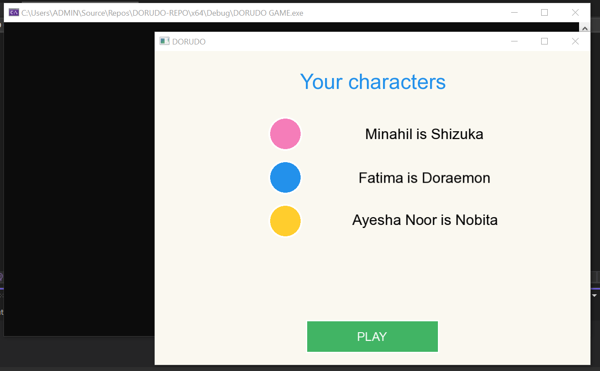
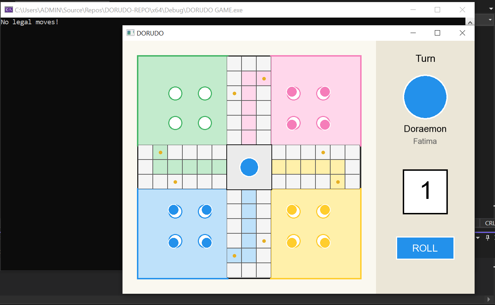
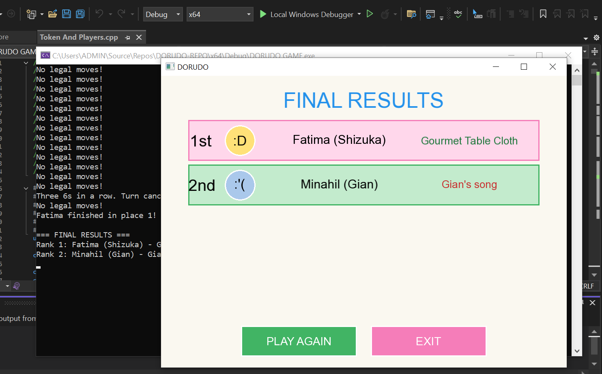

# DORUDO - A Doraemon-Themed Ludo Game

**Team:** [Minahil Khan, 26L-0854] and [Fatima Zahra, 26L-0855]

**Course:** Programming Fundamentals (1st semester project)

**Language / Library:** C++17 with SFML 3

## 1. Project Overview

DORUDO is a GUI-based Ludo game for 2 to 4 players on one computer. The game follows the normal Ludo rules, but everything is Doraemon themed. Each player types a name and the game randomly gives them one of four characters: Doraemon (blue), Nobita (yellow), Shizuka (pink) or Gian (green).

The game continues until only one player is left. Players who finish win Doraemon gadgets and the last player has to listen to Gian's song.

| Players | 1st | 2nd | 3rd | Last |
|---|---|---|---|---|
| 4 | Gourmet Table Cloth | Memory Bread | Translation Konjac | Gian's song |
| 3 | Gourmet Table Cloth | Memory Bread | - | Gian's song |
| 2 | Gourmet Table Cloth | - | - | Gian's song |

### Features
- Animated intro, main menu, instructions screen and player setup screen
- Random character assignment with a reveal screen
- Ludo board with yards, track, safe squares and home columns
- Roll button with an animated dice and a turn indicator
- Click a token to move it; it moves square by square
- Capturing, safe squares, blocks, exact roll to finish, extra turn on 6, three 6s cancel the turn
- Sound effects (dice, capture, gadget, Gian's song) and background music
- Ending screen with ranks, rewards, Play Again and Exit

### How to play
1. Click **START GAME**, read the instructions and choose the number of players (2-4).
2. Click a name box and type each player's name (Enter moves to the next box), then click **START**.
3. Click **ROLL**. You need a **6** to bring a token out of the yard.
4. After the dice stops, click the token you want to move.
5. A 6 gives another turn. Three 6s in a row cancel the turn.
6. Landing on a single opponent token (not on a safe square) sends it back to its yard.
7. You need the exact number to reach the final home square.

## 2. Prerequisites

- Windows 10 or 11 (64-bit)
- Visual Studio 2022 (Community is fine) with the workload **"Desktop development with C++"**
- Git (comes with Visual Studio)
- SFML 3.0.2 for **Visual C++ 17 (2022) - 64-bit** (already included in the `lib` folder of this repository, see `libraries.txt`)

## 3. Folder Structure

```
DORUDO-REPO/
|-- README.md
|-- libraries.txt
|-- lib/
|   `-- SFML/               (SFML include, lib and bin folders)
|-- DORUDO GAME/
|   |-- Token And Players.cpp   (full game source code)
|   |-- DORUDO GAME.vcxproj
|   `-- Audio/              (music and sound effects)
`-- screenshots/
```

## 4. Installation and Setup on a New PC

1. Install Visual Studio 2022 with **Desktop development with C++**.
2. Clone the repository:
   - Open Visual Studio > **Clone a repository** > paste the GitHub link > **Clone**.
   - Or use the command: `git clone <repository-link>`
3. Open the solution file (`.sln`) from the cloned folder.
4. At the top of Visual Studio choose **Debug** and **x64**.
5. Press **Ctrl + F5** to build and run.

The project is already set up to use the SFML files from the `lib` folder, so nothing needs to be installed separately.



### If the project does not find SFML (manual configuration)

Right-click the **project** (not the solution) > **Properties**, set **Configuration: All Configurations** and **Platform: x64**, then check:

| Setting | Value |
|---|---|
| C/C++ > Language > C++ Language Standard | ISO C++17 Standard (/std:c++17) |
| C/C++ > General > Additional Include Directories | `$(SolutionDir)lib\SFML\include` |
| Linker > General > Additional Library Directories | `$(SolutionDir)lib\SFML\lib` |
| Build Events > Post-Build Event > Command Line | `xcopy /y /d "$(SolutionDir)lib\SFML\bin\*.dll" "$(OutDir)"` |

Linker > Input > Additional Dependencies:
- **Debug:** `sfml-graphics-d.lib;sfml-window-d.lib;sfml-system-d.lib;sfml-audio-d.lib`
- **Release:** `sfml-graphics.lib;sfml-window.lib;sfml-system.lib;sfml-audio.lib`



## 5. Running the Game

Press **Ctrl + F5**. The intro screen appears, then the main menu.







## 6. Troubleshooting

| Problem | Solution |
|---|---|
| Many errors about C++ features or `std::optional` | Set the C++ language standard to **ISO C++17** (see the table above). |
| `Cannot open include file 'SFML/Graphics.hpp'` | The Additional Include Directories path is wrong. Check that the `lib\SFML\include` folder exists. |
| `LNK1104: cannot open file 'sfml-graphics-d.lib'` | The Additional Library Directories path is wrong, or the platform is not **x64**. |
| `sfml-graphics-d-3.dll was not found` (missing DLL) | Copy the DLLs from `lib\SFML\bin` into the folder of the `.exe`, or make sure the Post-Build Event command is set. |
| The program closes immediately or crashes at start | Make sure the platform is **x64** and that the SFML version matches Visual Studio 2022 (Visual C++ 17). |
| No music or sound | The `Audio` folder must be inside the project folder (next to the `.cpp` file) and the file names must not be changed. The game still works without sound. |
| Text is not shown | The game uses `C:/Windows/Fonts/arial.ttf`, which exists on Windows. Check that the font file is present. |
| Pull fails in Visual Studio | Choose **Merge**. Commit your own changes first, then pull. |

## 7. Acknowledgements

- SFML (Simple and Fast Multimedia Library): https://www.sfml-dev.org
- Doraemon characters, gadgets and Gian's song belong to Fujiko F. Fujio and are used only for this academic project.
- Sound effects and music: https://youtu.be/V0Qnt23V2zY?si=gtXfJrVo8r90hDPQ
- Claude was used for all SFML graphics codes and we asked for guidance in other codes from it as well. 

## 8. Contact

Team Lead: Minahil Khan, 26L-0854

Email: l260854@lhr.nu.edu.pk

GitHub: https://github.com/Minahil-Khan-P/DORUDO.git
